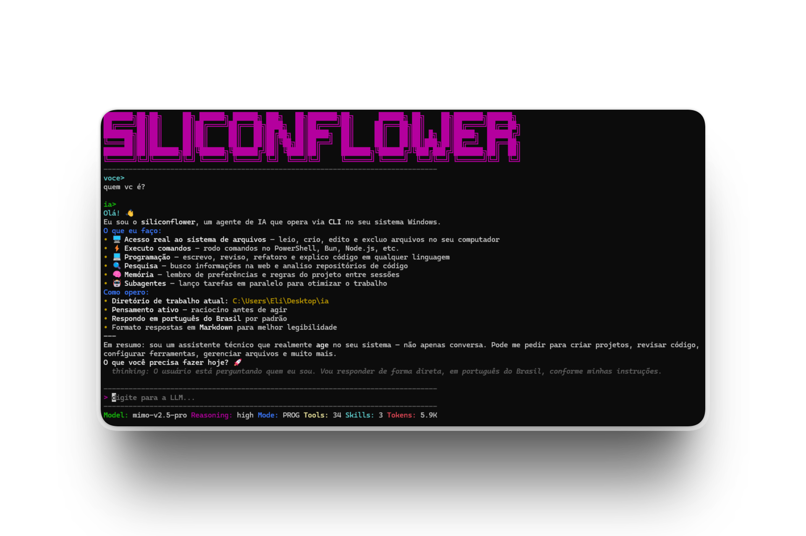

# 🌸 SILICONFLOWER


Agente de IA de alta performance para desenvolvimento de software em **Windows, Linux e macOS/Unix**, como **app de desktop** ou no **terminal (CLI/TUI)**. Integra **30 ferramentas nativas**, **Subagentes & Background Tasks**, **Memória Persistente**, **Git Worktrees**, **RepoMap**, **Busca Web** e **Protocolo MCP**, compatível com **SiliconFlow, OpenRouter, OpenAI** e demais backends compatíveis com a API da OpenAI.

<p align="center">
  
</p>

---

## ✨ Recursos Principais

- 🤖 **Subagentes & Background Tasks**: Agentes autônomos com papéis `general`, `research`, `verification`, `plan`, `coder` ou `custom`, executados em segundo plano. `research` e `plan` são somente leitura.
- 🧠 **Projetos & Memória sob demanda**: uma pasta vira projeto quando tem `SILICONFLOWER.md` ou `AGENTS.md` (crie com `siliconflower init`). O arquivo traz suas instruções do projeto e ativa a memória daquela pasta e das subpastas. As memórias que o agente salva ficam em `~/.siliconflower/workspaces/<workspace-id>/memory/`, fora do repositório, e só o índice (nome e descrição) entra no prompt; o conteúdo é lido quando relevante. Pastas sem arquivo começam sempre limpas.
- 🌳 **Git Worktrees Isolados**: Testes e refatorações em branches temporárias em `<repo>/.worktrees/<branch>` (excluída automaticamente via `.git/info/exclude`), sem afetar a área de trabalho atual.
- 🗺️ **RepoMap & Símbolos**: Mapeamento estrutural de código (TS, JS, Python, Go, Rust) com baixo consumo de tokens.
- ⚡ **Raciocínio & Modos de Operação**: Controle de *reasoning effort* (`Ctrl+E`) e modos de trabalho (`Ctrl+O`: `programação`, `sistema`, `plano`). Na API oficial Xiaomi MiMo, o atalho alterna o pensamento entre ligado e desligado.
- 🖥️ **TUI com Scroll Livre & Viewport Limpo**: Inicialização com tela limpa e suporte nativo completo à rolagem com a rodinha do mouse em respostas longas e blocos de código (estilo Claude Code).
- 🪟 **App de Desktop**: janela própria por projeto (Electron, AppImage no Linux), configuração sem terminal e conversas salvas que você retoma depois.
- 🌐 **Interface no Navegador**: `siliconflower gui` abre a mesma interface no Firefox ou em outro navegador, mostrando argumentos e resultados das ferramentas e tarefas.
- 🧩 **Ecossistema MCP & Hooks**: Suporte nativo ao Model Context Protocol e automações disparadas por eventos do ciclo de vida (`preTool`, `postTool`, `onEdit`, `onCommand`, `onSessionStart`, `onSessionEnd`).
- 📦 **Binário Nativo Standalone**: Compilação para binário único via Bun (`.exe` no Windows, `siliconflower` em Linux/Unix), sem necessidade de Node.js instalado.

---

## 🚀 Início Rápido

Um único código para Windows, Linux e macOS. O que muda entre os sistemas está em [docs/PLATAFORMAS.md](docs/PLATAFORMAS.md).

### App de desktop (recomendado)
1. Baixe na [última versão](https://github.com/1155dosilicon/siliconflower/releases/latest):
   - **Windows:** `Siliconflower-Setup-<versão>.exe`. Execute com dois cliques; não pede administrador. O instalador não é assinado, então o SmartScreen pode avisar: clique em **Mais informações** e em **Executar assim mesmo**.
   - **Linux:** `Siliconflower-<versão>-x86_64.AppImage`. Dê permissão de execução (`chmod +x Siliconflower-*.AppImage`) e abra.
2. Informe provedor, chave e modelo, e escolha a pasta do projeto. Não exige Bun nem Node.

### Modo terminal, sem compilar
Baixe na [última versão](https://github.com/1155dosilicon/siliconflower/releases/latest) o binário `siliconflower.exe` (Windows) ou `siliconflower-linux-x64` (Linux) e rode dentro da pasta do projeto. Para usar de qualquer pasta, coloque-o numa pasta do `PATH` (no Linux, renomeie para `siliconflower` e use `~/.local/bin`). Só é necessário se você quer o terminal: o app já traz o próprio agente.

### A partir do código-fonte

**Pré-requisitos:**
- Windows (PowerShell), Linux ou macOS/Unix (bash/sh).
- [Bun >= 1.3](https://bun.sh) para instalar dependências, executar a partir do código-fonte e compilar o binário.
- Como alternativa ao Bun, Node.js >= 20 com npm pode executar o launcher local após `npm install` (`node bin/siliconflower.js`). O comando `bun run start` requer Bun.

```bash
# 1. Clonar e instalar dependências
git clone https://github.com/1155dosilicon/siliconflower.git
cd siliconflower
bun install

# 2. Iniciar (abre o wizard de configuração na 1ª execução)
bun run start
```

#### Compilar e Instalar no PATH

**Linux / macOS:**
```bash
bun run build          # Gera dist/siliconflower
npm run install:bin    # Copia para ~/.local/bin
siliconflower          # Executa a partir de qualquer pasta
```

**Windows:**
```powershell
bun run build          # Gera dist/siliconflower.exe
npm run install:bin    # Adiciona ao PATH do usuário
siliconflower          # Executa a partir de qualquer pasta
```

Abra um novo terminal depois da instalação para carregar o PATH atualizado.

---

## ⚙️ Configuração & Armazenamento Isolado

As configurações globais e dados do Siliconflower ficam organizados em `~/.siliconflower/`:

- **Configurações:** `~/.siliconflower/config.json`
- **Habilidades (Skills):** `~/.siliconflower/skills/`
- **Memórias Globais:** `~/.siliconflower/memory/`
- **Artefatos Globais:** `~/.siliconflower/artifacts/`
- **Workspaces Isolados:** `~/.siliconflower/workspaces/<workspace-id>/` (armazena memórias, artefatos e hooks do projeto sem poluir o repositório local; o id vem da pasta que contém `SILICONFLOWER.md`/`AGENTS.md`)
- **Conversas da GUI e do app:** `~/.siliconflower/workspaces/<workspace-id>/sessions/`, em texto puro (veja [SECURITY.md](SECURITY.md))
- **Logs:** `~/.siliconflower/logs/`
- **Saídas Truncadas:** `~/.siliconflower/outputs/`

```json
{
  "baseURL": "https://api.siliconflow.com/v1",
  "apiKey": "sk-...",
  "model": "deepseek-ai/DeepSeek-V4-Pro",
  "reasoning": "high",
  "mode": "programação"
}
```

### Comandos de Gerenciamento & Flags CLI
```bash
bun run start -- --help
bun run start -- --version
bun run start -- gui          # Abre a interface gráfica no navegador padrão (--port <n>, --no-open)
bun run start -- config       # Reabre o assistente de configuração
bun run start -- init         # Cria SILICONFLOWER.md aqui (ativa a memória de projeto; --agents cria AGENTS.md)
bun run start -- show         # Exibe configuração mascarada, projeto ativo e diretório do workspace
bun run start -- ensure       # Cria configuração se ainda não existir
bun run start -- skills list  # Lista habilidades instaladas
bun run start -- skills sync  # Copia exemplos sem sobrescrever arquivos existentes
bun run start -- logs -n 100 --level error --search timeout
bun run start -- -m <model> -r <level> --mode <mode> --base-url <url>
```

O comando `sync` também é um atalho para `skills sync`. `logs` aceita `-n/--lines`, `-l/--level` (`error`, `warn`, `info` ou `tool`), `-s/--search` e `--clear`.

As opções de execução `--model`, `--reasoning`, `--mode`, `--base-url` e `--api-key` substituem os valores para aquela execução e não salvam a configuração. Para persistir mudanças, use `config` ou edite `config.json`.

As variáveis `SILICONFLOWER_API_KEY`, `SILICONFLOWER_BASE_URL` e `SILICONFLOWER_MODEL` substituem os valores equivalentes de `config.json`; as opções passadas na linha de comando prevalecem sobre ambos. Esses valores de ambiente nunca são gravados em `config.json` (nem pelo comando `config`); `show` indica quando alguma variável está ativa. Valores inválidos em `--reasoning` ou `--mode` encerram com erro em vez de serem ignorados.

### Xiaomi MiMo

Quando `baseURL` usa `xiaomimimo.com` ou um subdomínio oficial, o Siliconflower trata o raciocínio como um controle binário: `none` desativa o pensamento e `high` o ativa. O assistente de configuração mostra as opções `off` e `on`, e `Ctrl+E` alterna entre elas. O pedido envia `thinking.type` como `disabled` ou `enabled`; outros provedores compatíveis com OpenAI continuam usando `reasoning_effort` com `none`, `low`, `medium` ou `high`.

---

## ⌨️ Atalhos & Modos de Operação

### Atalhos no Terminal (TUI)
| Atalho | Ação |
| :--- | :--- |
| `Enter` | Envia a mensagem |
| `Ctrl+E` | Alterna o nível de raciocínio (`none` ➔ `low` ➔ `medium` ➔ `high`); na API oficial Xiaomi MiMo, alterna pensamento desligado/ligado |
| `Ctrl+O` | Alterna o modo de operação (`programação` ➔ `sistema` ➔ `plano`) |
| `Ctrl+C` | Cancela a geração (ou a pergunta de `ask_question`) em andamento; com o agente ocioso, sai |

### Interface Gráfica (`siliconflower gui`)
Rode o comando **dentro da pasta do projeto**: ela é a pasta de trabalho do agente. A página abre no navegador padrão (`xdg-open` no Linux, `open` no macOS, `Start-Process` no Windows); com `--no-open`, copie a URL do terminal para o navegador que preferir. Requer Bun ou o binário compilado (não roda com Node + tsx).

As opções `--model`, `--reasoning`, `--mode`, `--base-url` e `--api-key` também valem aqui. Para vários projetos ao mesmo tempo, rode um `gui` em cada pasta: cada um usa sua própria porta e conversa. A configuração inicial continua no terminal, com `siliconflower config`.

| Na página | Ação |
| :--- | :--- |
| `Enter` / `Shift+Enter` | Envia a mensagem / quebra a linha |
| `Esc` ou botão **Parar** | Cancela a resposta (ou a pergunta) em andamento |
| Seletores **Modo** e **Pensamento** | Equivalem a `Ctrl+O` e `Ctrl+E` |

Enquanto o agente trabalha, a página mostra um aviso **Pensando...** até o fim do turno, sem o texto do raciocínio; durante uma ferramenta, quem mostra a atividade é o cartão dela. As conversas ficam salvas por projeto, na lateral: **+ Nova conversa** começa outra, clicar em uma retoma de onde parou e **×** apaga. Na TUI, a conversa continua terminando ao sair. Fechar a aba encerra o agente depois de cerca de 15 segundos; `Ctrl+C` no terminal encerra na hora. Uma resposta só é salva ao terminar ou ser interrompida: se o agente cair no meio dela, ela se perde. A URL traz um token de acesso: não a compartilhe (veja [SECURITY.md](SECURITY.md)).

### App de Desktop
A mesma interface em janela própria, sem terminal nem navegador. No Linux, o pacote é um AppImage (`Siliconflower-<versão>-x86_64.AppImage`): dê permissão de execução (`chmod +x`) e abra. No Windows, é um instalador por usuário, sem administrador. O app traz o agente e o Electron e não coloca `siliconflower` no `PATH`: o modo terminal é instalado à parte.

Para gerar o pacote a partir do código-fonte, ou desenvolver sem empacotar:

```bash
bun install                    # só na primeira vez
bun install --cwd desktop      # só na primeira vez: baixa o Electron
bun run desktop:dist           # gera em dist-desktop/ o pacote da plataforma atual (AppImage no Linux, instalador .exe no Windows)

bun run build                  # ou, sem empacotar: compila o agente
bun run desktop                # e abre o app a partir do código-fonte
```

Na tela inicial, escolha a pasta do projeto. Cada projeto abre em sua própria janela, com seu agente e suas conversas; `Ctrl+O` abre outra pasta e `Ctrl+Shift+O` mostra os recentes. Fechar a janela encerra o agente e os comandos em background daquele projeto, e as conversas continuam salvas. Abrir o projeto de novo começa com uma conversa vazia, para não gastar tokens com contexto antigo; a anterior está na lateral.

- **Configuração:** na primeira vez, o app pede provedor, chave e modelo, e **Testar conexão** confere se funcionam. Depois, use **Arquivo > Configurações** (`Ctrl+,`). A chave nunca volta para a tela: em branco, mantém a salva. Projetos abertos podem reiniciar na hora para usar a mudança, sem perder a conversa.
- **Variáveis de ambiente:** aberto pelo menu de aplicativos, o app herda o ambiente da sessão gráfica, não o de um terminal. Variáveis definidas só no `.bashrc`/`.zshrc` (`SILICONFLOWER_API_KEY`, ou um `PATH` usado por MCP e hooks) podem não chegar ao agente; defina-as em `~/.profile` ou `~/.config/environment.d/` (Linux) ou nas variáveis de ambiente do usuário (Windows).

### Modos de Trabalho
- **`programação`**: Acesso completo a ferramentas de código, leitura, escrita e testes.
- **`sistema`**: Focado em administração de SO, processos e scripts de shell (PowerShell no Windows, bash/sh em Linux/Unix).
- **`plano`**: Modo de planejamento com allowlist de leitura, perguntas e checklist da sessão — bloqueia edições de arquivo, comandos e ferramentas MCP.

`programação` e `sistema` mudam o foco do prompt, mas não isolam o agente nem limitam seus privilégios. O modo `plano` aplica uma allowlist explícita; ferramentas MCP e ferramentas não reconhecidas são bloqueadas por padrão. Hooks `onSessionStart` e `onSessionEnd` configurados inline ainda podem executar comandos nesse modo. Consulte [SECURITY.md](SECURITY.md) antes de conceder acesso ao computador.

---

## 🛠️ Ferramentas Nativas

O Siliconflower disponibiliza um conjunto completo de ferramentas integradas:

- 📁 **Arquivos & Edição**: `read_file`, `read_media` (imagem em qualquer provedor; áudio e vídeo na API Xiaomi MiMo), `write_file`, `edit_file` (fuzzy/newline matching), `apply_patch`, `list_directory`, `create_directory`, `move_path`, `delete_path`, `file_info`.
- 🔍 **Busca & Navegação**: `search_files` (glob), `grep_content` (regex), `repo_map`, `find_symbol`.
- 💻 **Execução & Tarefas**: `execute_command` (shell arbitrário com os privilégios do usuário — PowerShell no Windows com saída em UTF-8, `$SHELL` em Linux/Unix), `read_logs`, `ask_question` (pausa e espera sua resposta na TUI), `todowrite`, `read_skill`.
- 🤖 **Subagentes & Async**: `run_task`, `send_subagent_message`, `manage_background_task`.
- 🧠 **Memória & Worktrees**: `memory` (`save`, `recall`, `forget`), `enter_worktree`, `exit_worktree`, `list_worktrees`.
- 📄 **Artefatos & Web**: `artifact` (`create`, `read`, `list`, `delete`), `web_fetch` (HTML para Markdown), `web_search`, `show_hooks`.

> 📖 Arquitetura e detalhes de cada ferramenta: [docs/ARCHITECTURE.md](docs/ARCHITECTURE.md). Vai mexer no código, ou é um agente de IA? Comece por [AGENTS.md](AGENTS.md).

---

## 🧩 Extensibilidade

### Servidores MCP (`~/.siliconflower/config.json`)
```json
{
  "mcpServers": {
    "filesystem": {
      "command": "npx",
      "args": ["-y", "@modelcontextprotocol/server-filesystem", "/home/user/Workspace"]
    }
  }
}
```

As ferramentas MCP são anunciadas à LLM com nomes qualificados e estáveis no formato `mcp_<servidor>_<ferramenta>_<hash>`. Isso evita colisões entre servidores ou com ferramentas nativas; o nome original continua sendo usado ao chamar o servidor.

### Testes e diretório de dados alternativo

Defina `SILICONFLOWER_DATA_DIR` para redirecionar `config.json`, logs e os demais dados persistentes para outro diretório. A suíte de testes usa essa variável automaticamente e não grava no perfil real do usuário.

### Hooks de Automação
```json
{
  "hooks": {
    "onEdit": "bun x tsc --noEmit",
    "postTool": "git status --short"
  }
}
```

### Habilidades Customizadas (Skills)
Crie arquivos Markdown em `~/.siliconflower/skills/` com instruções especializadas. O agente as carrega sob demanda com `read_skill`.

---

## 🩺 Diagnóstico rápido

- **HTTP 401:** confira a chave em `config.json` e a variável `SILICONFLOWER_API_KEY`.
- **HTTP 404:** confira o endereço base (normalmente terminado em `/v1`) e o identificador exato do modelo no provedor.
- **Servidor MCP indisponível:** confirme `command`, `args` e dependências do servidor. Falhas de conexão aparecem como aviso na barra de status e são gravadas no log; as ferramentas nativas continuam disponíveis. Consulte os detalhes com `bun run start -- logs --level error`.
- **Acentos corrompidos na saída de comandos (Windows):** a partir da v0.2.7, `execute_command`, hooks e tarefas em background forçam UTF-8 no PowerShell e rodam com `-NoProfile` (o seu `$PROFILE` não é carregado nesses comandos).
- **Alias ou função do shell não funciona em `execute_command` (Linux/Unix):** os comandos rodam com `$SHELL -c`, não interativo e sem login, então `.bashrc`/`.zshrc` não são carregados. Use o caminho completo do programa ou exporte as variáveis antes de abrir o `siliconflower`.
- **O agente lembra de coisas de outro projeto / não lembra de nada:** a memória de projeto só existe em pastas com `SILICONFLOWER.md` ou `AGENTS.md` (nela ou acima dela). Confira com `siliconflower show` (linha `Project`) ou na barra de status (`Projeto:`). Abra o agente dentro da pasta do projeto, ou rode `siliconflower init` para criar um. Memórias globais (`~/.siliconflower/memory/`) aparecem em qualquer pasta.
- **Comando em background parou ao sair:** fechar a TUI, a GUI ou a janela do projeto encerra os comandos em background e o que eles iniciaram. Para um processo que deve continuar, inicie-o fora do agente (`systemd`, `tmux`, `nohup` em outro terminal).
- **Resposta ou arquivo grande cortado:** cada resposta do modelo tem limite de 32768 tokens de saída, ou 16384 se o provedor recusar esse valor. O raciocínio pode contar nesse limite, conforme o provedor. O modelo é avisado do corte e pode escrever o arquivo em partes; em um texto cortado, envie `continue`.
- **Problema no app de desktop:** o log fica em `~/.siliconflower/logs/siliconflower.log`. Instalar o app não instala o comando `siliconflower`.
- **Comando não encontrado após instalar o binário:** abra uma nova janela do terminal para carregar o PATH atualizado. No Linux, confirme que `~/.local/bin` está no `PATH`.

---

## 📁 Estrutura do Projeto

```text
siliconflower/
├── src/                  # Código (mapa em AGENTS.md)
├── desktop/              # App de desktop em Electron (instalador Windows / AppImage)
├── .github/workflows/    # CI (testes em Windows e Linux) e release
├── tests/                # bun test
├── scripts/              # Instalação no PATH (install.sh / install.ps1) e empacotamento
├── docs/ARCHITECTURE.md  # Arquitetura e referência técnica
├── docs/PLATAFORMAS.md   # O que muda entre Windows e Linux/Unix
├── AGENTS.md             # Guia curto para agentes de IA e contribuidores (CLAUDE.md aponta para ele)
├── CONTRIBUTING.md · SECURITY.md · CHANGELOG.md
└── build.ts              # Compilação do binário standalone (Bun)
```

---

## 📜 Licença

Distribuído sob a licença **MIT**. Veja [LICENSE](LICENSE) para mais informações.
